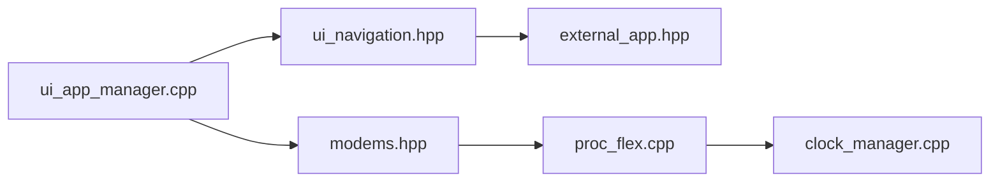

# portapack-mayhem/mayhem-firmware

> Firmware d'applications radio pour HackRF/PortaPack, pour passionnés de SDR.

## Le problème
Le matériel HackRF + PortaPack de base manque d'applications et de correctifs.

## Ce que ça fait vraiment
Fork de Havoc (lui-même fork du firmware PortaPack). Applications intégrées et externes : réception, émission, analyse. Couches : gestionnaire d'applications, UI, modems, baseband, horloge, bus I²C. Le README renvoie les nouveaux venus à des guides.

## Comment c'est branché

## Essayer
Aucune commande : le README renvoie à la page de la dernière release et à ses instructions.

## Coût et pièges
Nécessite le matériel (H4M, H2…). Le README met en garde contre vendeurs aux firmwares non compatibles et contre les revendeurs payants du firmware.

## Ce que ce n'est pas
Pas un logiciel pour PC. Les clones H3 utilisent leur propre firmware.

## Alternatives
Aucune alternative citée dans le README.

## Pour toi
À ignorer : firmware embarqué radio, sans lien avec data / IA / MLOps.

