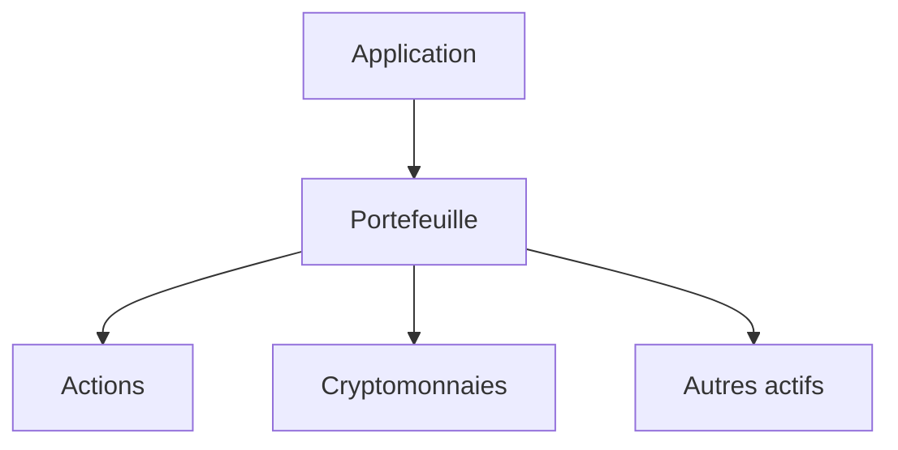

# portfolio-performance/portfolio

> Application for tracking the performance of a portfolio of stocks, cryptocurrencies and other assets.

## The problem
Tracking the real performance of a portfolio spread across several accounts and assets requires a dedicated tool.

## What it actually does
The README is only a few lines long: it announces performance tracking and evaluation, then points to the home page, downloads, forum and manual. It publishes the fingerprint of the GPG signing key. The detail of the features is not documented here.

## How it is wired
Simplified diagram based on the sheet, no diagram provided.


## Trying it
```bash
# Aucune commande documentée dans le README.
```

## Cost and gotchas
Nothing is specified about prerequisites or price data. The repository has 519 open issues. EPL-1.0 license, to be read before redistribution.

## What it is not
It is not an investment advisor. The sheet stays minimal: the README says nothing more.

## Alternatives
No alternative named in the README.

## For you
Watch only for personal use: portfolio tracking has no direct link to a data or AI job, and the README is too thin to judge further.
