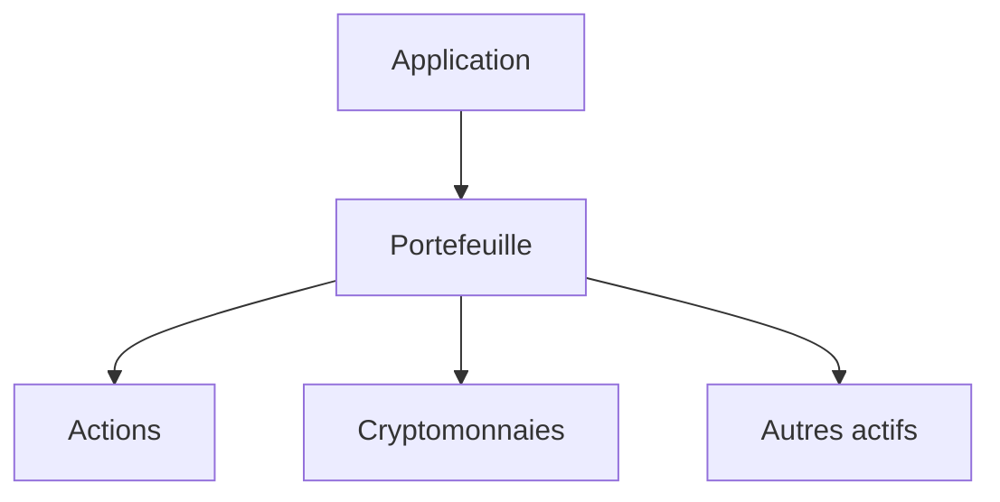

# portfolio-performance/portfolio

> Application de suivi de performance d'un portefeuille d'actions, cryptomonnaies et autres actifs.

## Le problème
Suivre la performance réelle d'un portefeuille éparpillé sur plusieurs comptes et actifs demande un outil dédié.

## Ce que ça fait vraiment
Le README tient en quelques lignes : il annonce le suivi et l'évaluation de la performance, puis renvoie vers la page d'accueil, les téléchargements, le forum et le manuel. Il publie l'empreinte de la clé GPG de signature. Le détail des fonctions n'est pas documenté ici.

## Comment c'est branché
Schéma simplifié d'après la fiche, sans diagramme fourni.


## Essayer
```bash
# Aucune commande documentée dans le README.
```

## Coût et pièges
Rien n'est précisé sur les prérequis ni sur les données de cours. Le dépôt a 519 issues ouvertes. Licence EPL-1.0, à lire avant redistribution.

## Ce que ce n'est pas
Ce n'est pas un conseiller en investissement. La fiche reste minimale : le README ne dit rien de plus.

## Alternatives
Aucune alternative nommée dans le README.

## Pour toi
À surveiller seulement à titre personnel : le suivi de portefeuille n'a pas de lien direct avec un métier data ou IA, et le README est trop mince pour juger davantage.

