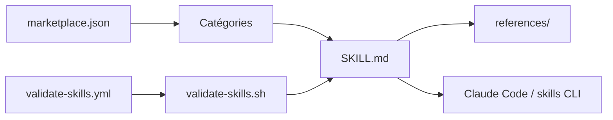

# posit-dev/skills

> Collection of Posit agent skills for R, Shiny, Quarto, GitHub and code review, installable in Claude Code and others.

## The problem
A coding agent does not know the fine-grained conventions of R, Shiny, Quarto or PR workflows. These skills provide them.

## What it actually does
Markdown content repository: each skill is a folder with a `SKILL.md` and optional `references/`. Categories: developer (critical review, design doc, work tracking, test review), GitHub (create a PR, handle and resolve threads), open source (release checklist, release post), R (testthat, cli, lifecycle, mirai…), ggsql, Shiny/bslib, Quarto, Posit Connect. A GitHub Action validates the structure.

## How it is wired


## Trying it
```bash
npx skills add posit-dev/skills --list
npx skills add posit-dev/skills --all
npx skills add posit-dev/skills --agent claude-code --global
```
In Claude Code: `/plugin marketplace add posit-dev/skills`.

## Cost and gotchas
Free. Some skills call GitHub or require an R runtime (release scripts). Skills are activated automatically depending on the task.

## What it is not
Neither an application nor a library: instruction content. The R/Shiny skills are of little use outside the Posit ecosystem.

## Alternatives
- Anthropic's Official Skills Repository: reference source listed in the resources.

## For you
Adopt if you work in R/Shiny/Quarto or want review skills (critical-code-reviewer, review-testing): MIT, identified publisher, simple installation.
