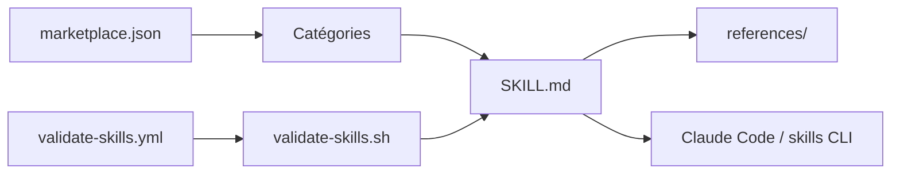

# posit-dev/skills

> Collection de skills d'agents de Posit pour R, Shiny, Quarto, GitHub et revue de code, installables dans Claude Code et autres.

## Le problème
Un agent de code ne connaît pas les conventions fines de R, Shiny, Quarto ou des workflows de PR. Ces skills les lui fournissent.

## Ce que ça fait vraiment
Dépôt de contenu Markdown : chaque skill est un dossier avec un `SKILL.md` et des `references/` optionnelles. Catégories : développeur (revue critique, doc de design, suivi de travail, revue de tests), GitHub (créer une PR, traiter et résoudre les threads), open source (checklist de release, article de release), R (testthat, cli, lifecycle, mirai…), ggsql, Shiny/bslib, Quarto, Posit Connect. Une GitHub Action valide la structure.

## Comment c'est branché


## Essayer
```bash
npx skills add posit-dev/skills --list
npx skills add posit-dev/skills --all
npx skills add posit-dev/skills --agent claude-code --global
```
Dans Claude Code : `/plugin marketplace add posit-dev/skills`.

## Coût et pièges
Gratuit. Certains skills appellent GitHub ou exigent un runtime R (scripts de release). Les skills sont activés automatiquement selon la tâche.

## Ce que ce n'est pas
Ni une application ni une bibliothèque : du contenu d'instructions. Les skills R/Shiny servent peu hors de l'écosystème Posit.

## Alternatives
- Anthropic's Official Skills Repository : source de référence listée dans les ressources.

## Pour toi
À adopter si tu travailles en R/Shiny/Quarto ou veux des skills de revue (critical-code-reviewer, review-testing) : MIT, éditeur identifié, installation simple.

