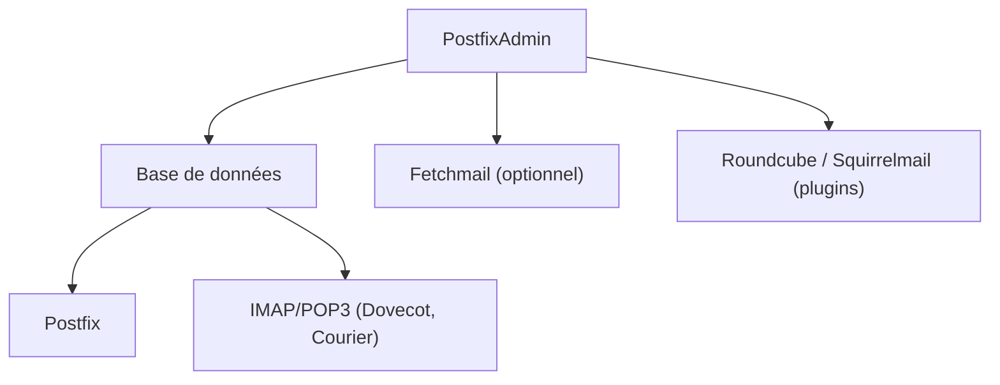

# postfixadmin/postfixadmin

> PHP web interface to manage the domains, mailboxes and aliases of a Postfix mail server.

## The problem
Managing the domains, mailboxes and aliases of a Postfix server by hand in database tables is tedious and risky.

## What it actually does
A web application that administers domains, mailboxes and aliases on a SQLite, MySQL, MariaDB or PostgreSQL database. It handles quotas, password expiration (beta), out-of-office autoresponder, TOTP, application passwords, DKIM storage and an optional XMLRPC API. Users can change their password.

## How it is wired


## Trying it
```bash
vendor/bin/phpunit tests
composer format
composer psalm
```
These commands are for development: installation goes through the installation guide.

## Cost and gotchas
Free, but you need PHP 8.2+, a web server and a database. The master branch "may eat your data": use a stable release.

## What it is not
It is not a mail server: it assumes Postfix and an IMAP server are already in place. No data/AI use case. License present but not identified by GitHub.

## Alternatives
mailserver2/mailserver: a complete mail stack in Docker images that already includes PostfixAdmin.

## For you
Ignore: a mail administration tool unrelated to data or AI, useful only if you host your own Postfix.
