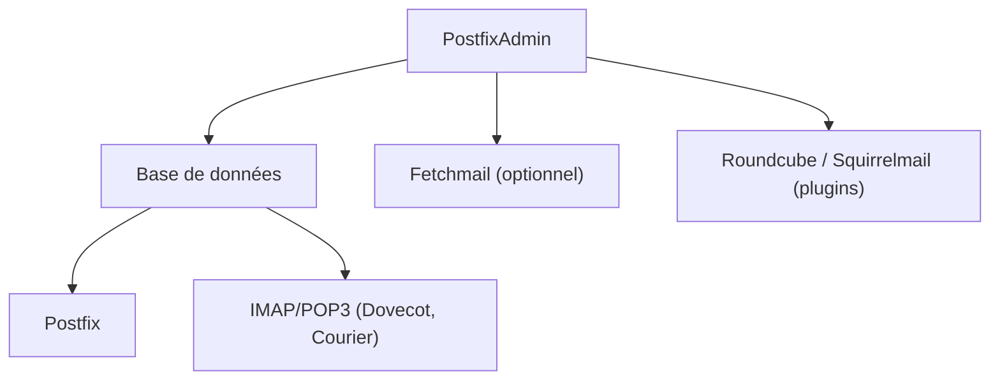

# postfixadmin/postfixadmin

> Interface web PHP pour gérer domaines, boîtes et alias d'un serveur mail Postfix.

## Le problème
Gérer à la main les domaines, boîtes et alias d'un serveur Postfix dans des tables de base de données est fastidieux et risqué.

## Ce que ça fait vraiment
Une application web qui administre domaines, boîtes et alias sur une base SQLite, MySQL, MariaDB ou PostgreSQL. Elle gère quotas, expiration de mots de passe (bêta), répondeur d'absence, TOTP, mots de passe d'application, stockage DKIM et une API XMLRPC optionnelle. Les utilisateurs peuvent changer leur mot de passe.

## Comment c'est branché


## Essayer
```bash
vendor/bin/phpunit tests
composer format
composer psalm
```
Ces commandes servent au développement : l'installation passe par le guide d'installation.

## Coût et pièges
Gratuit, mais il faut PHP 8.2+, un serveur web et une base. La branche master « peut manger vos données » : utiliser une release stable.

## Ce que ce n'est pas
Ce n'est pas un serveur mail : il suppose Postfix et un serveur IMAP déjà en place. Pas de cas data/IA. Licence présente mais non identifiée par GitHub.

## Alternatives
mailserver2/mailserver : une pile mail complète en images Docker qui inclut déjà PostfixAdmin.

## Pour toi
Ignorer : outil d'administration mail sans rapport avec la data ou l'IA, utile seulement si tu héberges ton propre Postfix.

