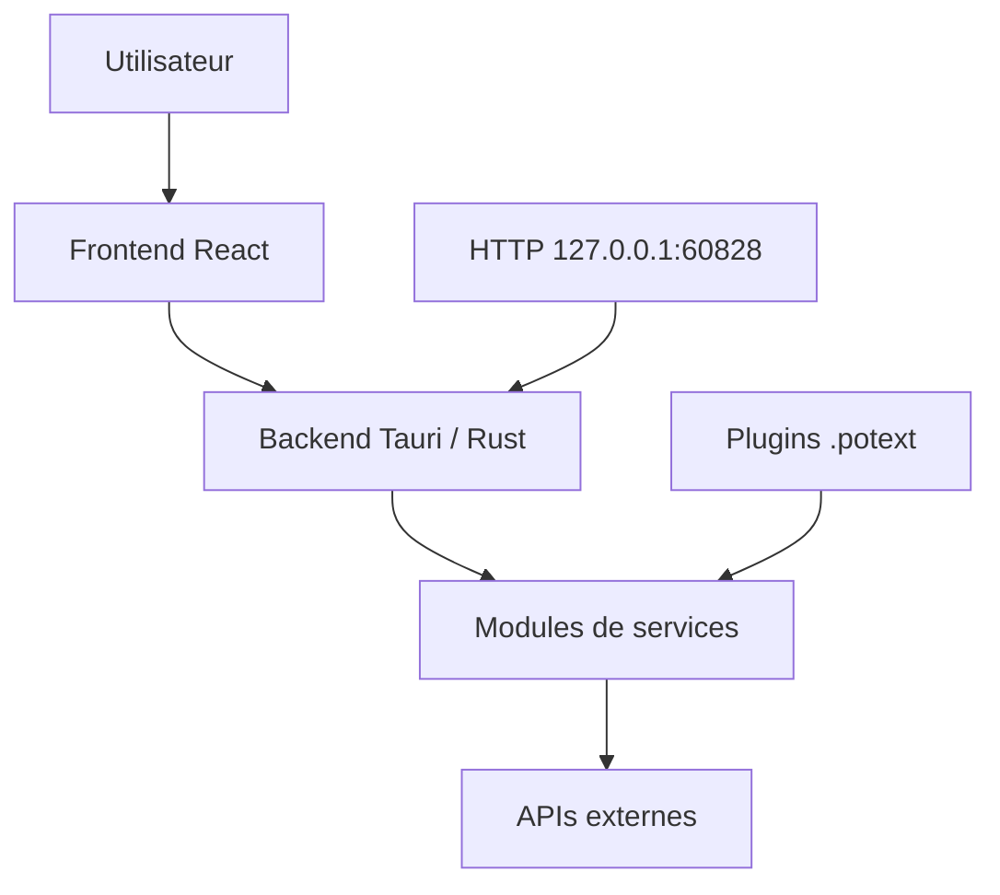

# pot-app/pot-desktop

> Cross-platform selected-text translator with OCR and several engines, for desktop users.

## The problem
Translating text on screen means copying, opening a website, pasting. Even more so for text inside an image.

## What it actually does
Tauri application (React frontend, Rust backend): translation by selection, typing, clipboard, screen OCR and screenshot translation. It queries many services in parallel (OpenAI, Gemini, DeepL, Google, local Ollama, etc.), offers system OCR or Tesseract, text-to-speech and export to Anki. A local HTTP server (port 60828) lets other tools call it. `.potext` plugin system. The README is in Chinese.

## How it is wired


## Trying it
```bash
winget install Pylogmon.pot
brew tap pot-app/homebrew-tap
brew install --cask pot
pnpm install
pnpm tauri dev
```

## Cost and gotchas
The software is free, but most engines require an API key or send your text to third parties. The repository is archived (last push 2026-07-04): no more fixes expected. Under Wayland, built-in shortcuts and capture do not work.

## What it is not
It is not a translation engine: it is a client that aggregates third-party services.

## Alternatives
The README cites Bob (macOS) as a source of inspiration, without presenting it as a direct alternative.

## For you
Ignore: archived and off-topic for a data/AI profile; the principle (aggregating several translation LLMs) can be imitated in a few scripts.
