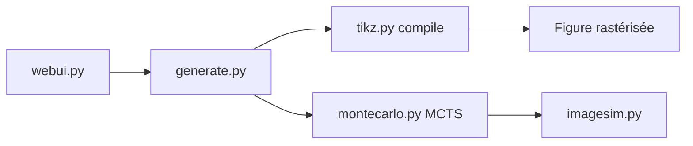

# potamides/DeTikZify

> Multimodal model that turns sketches and scientific figures into compilable TikZ programs.

## The problem
Recreating a scientific figure as TikZ vectors from an image or a sketch is time-consuming.

## What it actually does
Generates TikZ code from an image, or from text with TikZero and TikZero+. An MCTS algorithm refines the outputs without retraining, ranking candidates by image similarity. The TikZ code is compiled and rasterized. Web interface, weights and datasets on Hugging Face (DaTikZ lightened because of the arXiv license).

## How it is wired


## Trying it
```bash
pip install 'detikzify[legacy] @ git+https://github.com/potamides/DeTikZify'
python -m detikzify.webui --light
```

## Cost and gotchas
Requires TeX Live 2023, ghostscript and poppler; a GPU for the 8b/10b models. A Hugging Face Space and a Colab notebook (1b only on the free tier) exist.

## What it is not
Not a figure editor: the output still needs reviewing. The public dataset is incomplete.

## Alternatives
No alternative named in the README (it builds on AutomaTikZ).

## For you
Worth watching: a concrete demonstration of render-guided code generation and MCTS search, useful if you make TikZ figures; otherwise a niche.
