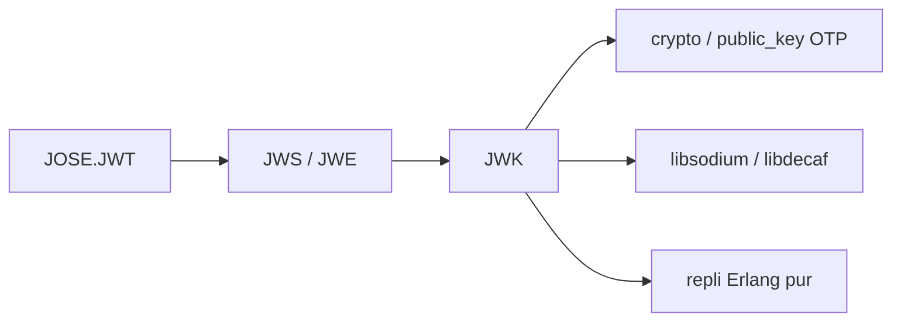

# potatosalad/erlang-jose

> JOSE implementation (JWT, JWS, JWE, JWK) for Erlang and Elixir, for developers of those ecosystems.

## The problem
Signing, encrypting and verifying JSON tokens requires covering many algorithms that the native crypto modules do not all handle.

## What it actually does
Implements JWT, JWS, JWE and JWK with a long list of algorithms (HS/RS/PS/ES/EdDSA, RSA-OAEP, ECDH-ES, AES-GCM, ChaCha20...). Uses native crypto, with a pure Erlang fallback (disabled by default) that is not resistant to timing attacks. The `none` algorithm is disabled by default; `verify_strict` restricts the accepted algorithms.

## How it is wired


## Trying it
```elixir
{:jose, "~> 1.11"}   # dans mix.exs
signed = JOSE.JWT.sign(jwk, jws, jwt)
{verified, _, _} = JOSE.JWT.verify_strict(jwk, ["HS256"], token)
```

## Cost and gotchas
Free. Before OTP 27, a JSON encoder is required (Jason, jsx, etc.). The pure Erlang fallback should be avoided with long-lived keys.

## What it is not
It is not an authentication service: only the library. Its low-level RSA padding helpers must not be exposed to untrusted ciphertexts.

## Alternatives
No alternative named in the README.

## For you
Ignore: reserved for Erlang/Elixir projects; outside that scope, it brings you nothing.
