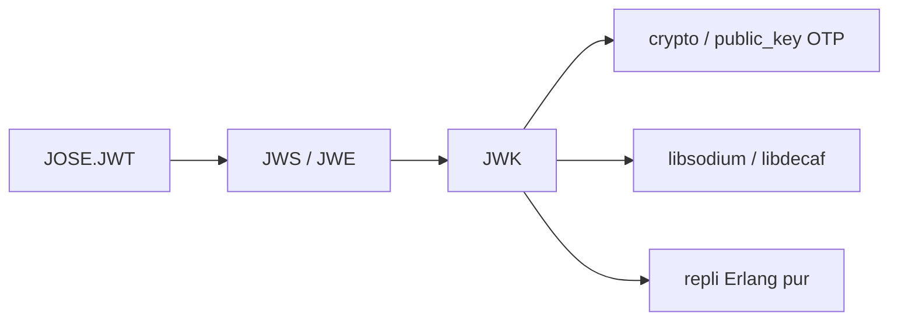

# potatosalad/erlang-jose

> Implémentation JOSE (JWT, JWS, JWE, JWK) pour Erlang et Elixir, pour développeurs de ces écosystèmes.

## Le problème
Signer, chiffrer et vérifier des jetons JSON demande de couvrir de nombreux algorithmes que les modules crypto natifs ne gèrent pas tous.

## Ce que ça fait vraiment
Implémente JWT, JWS, JWE et JWK avec une longue liste d'algorithmes (HS/RS/PS/ES/EdDSA, RSA-OAEP, ECDH-ES, AES-GCM, ChaCha20...). Utilise le crypto natif, avec un repli en Erlang pur (désactivé par défaut) non résistant aux attaques temporelles. Algorithme `none` désactivé par défaut ; `verify_strict` restreint les algorithmes acceptés.

## Comment c'est branché


## Essayer
```elixir
{:jose, "~> 1.11"}   # dans mix.exs
signed = JOSE.JWT.sign(jwk, jws, jwt)
{verified, _, _} = JOSE.JWT.verify_strict(jwk, ["HS256"], token)
```

## Coût et pièges
Gratuit. Avant OTP 27, il faut un encodeur JSON (Jason, jsx, etc.). Le repli Erlang pur est à éviter avec des clés longue durée.

## Ce que ce n'est pas
Ce n'est pas un service d'authentification : seulement la bibliothèque. Ses helpers de padding RSA de bas niveau ne doivent pas être exposés à des chiffrés non fiables.

## Alternatives
Aucune alternative nommée dans le README.

## Pour toi
Ignorer : réservé aux projets Erlang/Elixir ; hors de ce périmètre, il ne t'apporte rien.

