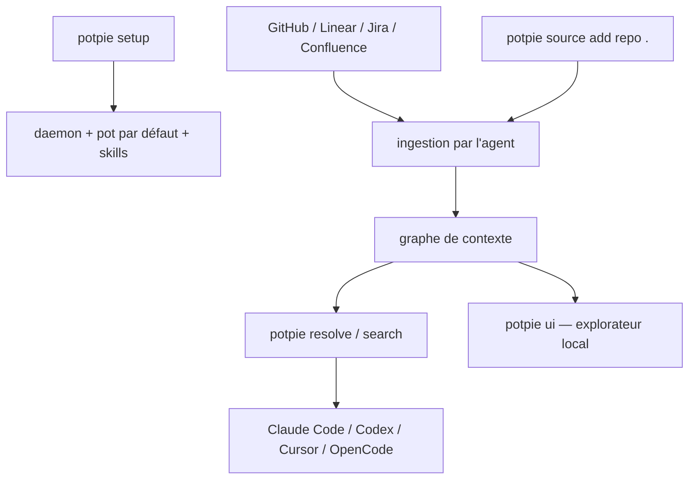

# potpie-ai/potpie

> Local context graph that indexes code, history and tickets for your agents.

## The problem
An agent discovering a repository knows neither past decisions, nor conventions, nor the link between a ticket and the code that implements it.
Every session restarts exploration from zero.

## What it actually does
It indexes code, its structure, decisions, source history, team knowledge and engineering workflows into a context graph.
`potpie resolve "..."` outputs the context an agent should read before a task; `potpie search "..."` targets a file, a bug, a decision or a convention.
`potpie record --type decision --summary "..."` writes a durable learning into the graph, which later sessions will find again.
Integrations cover GitHub (repositories, PRs, issues, reviews), Linear, Jira and Confluence; supported harnesses are Claude Code, Codex, Cursor and OpenCode.

## How it is wired


## Trying it
```bash
uv tool install potpie
potpie setup --repo . --agent claude
potpie github login
potpie source add repo .
potpie resolve "what should I know before working in this repository?"
potpie search "authentication flow"
potpie ui
```

## Cost and gotchas
`potpie login` exists for "managed, account-backed features": part of the value sits behind an account, with no pricing grid in the README.
Indexing touches code, PRs and tickets — consider this before plugging it into a private company repository.

## What it is not
It is not an agent: it produces context that your harness consumes. It is not an index to launch by hand either — there is no ingestion command, the agent does it when the task requires.
The architecture is declared "CLI-first" and the README points to `docs/context-graph/architecture.md` for details.

## Alternatives
No alternative is named in the README.

## For you
The idea of a project memory shared across sessions is solid; check what requires `potpie login` before investing in it.
