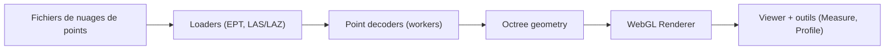

# potree/potree

> Open-source WebGL viewer for displaying very large point clouds in a browser.

## The problem
A point cloud with billions of points cannot be opened as-is in a browser.

## What it actually does
Loaders read the Potree, EPT and LAS/LAZ formats; workers decode the attributes; an octree geometry provides the visible points; WebGL rendering relies on three.js. Measurement tools, profiles, clipping, annotations, camera animation, export, optional integration of Cesium and WebXR. Point clouds must first be converted with PotreeConverter.

## How it is wired


## Trying it
```bash
npm install
npm start
# puis http://localhost:1234/examples/
# conversion : ./PotreeConverter.exe C:/pointclouds/data.las -o C:/pointclouds/data_converted
```

## Cost and gotchas
Free. Node only to build; simple file hosting is enough to serve. License "present but unidentified" according to GitHub: read it. Last push on 2026-01-08.

## What it is not
Not point cloud processing software: it is a viewer. Data must be converted first.

## Alternatives
No alternative named in the README (PotreeConverter and PotreeDesktop are companions).

## For you
To watch: useful if you need to publish LiDAR or photogrammetry surveys in a web page; off-topic for tabular data.
