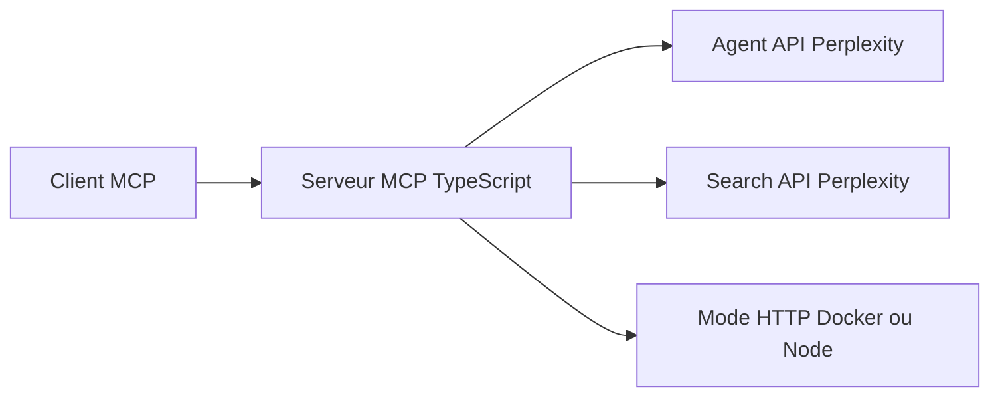

# ppl-ai/modelcontextprotocol

> Perplexity's official MCP server that gives an assistant web search and reasoning.

## The problem
An assistant without web access answers with dated knowledge.

## What it actually does
Four tools: `perplexity_search` (ranked results, recency and domain filters), `perplexity_ask`, `perplexity_reason` and `perplexity_research` (long streaming research), backed by Agent API presets. Hosted remote server (`https://api.perplexity.ai/mcp`), local server via npx, self-hosted HTTP mode (Docker or Node), library usage, enterprise proxy.

## How it is wired


## Trying it
```bash
claude mcp add perplexity --env PERPLEXITY_API_KEY="your_key_here" -- npx -y @perplexity-ai/mcp-server
claude mcp add --transport http perplexity https://api.perplexity.ai/mcp --header "Authorization: Bearer YOUR_API_KEY"
```

## Cost and gotchas
A Perplexity API key is mandatory and billing is on you. Deep research can take several minutes (default timeout of 5 minutes). In HTTP mode, binds to loopback by default.

## What it is not
Not a standalone search engine: everything depends on the Perplexity SaaS. The old version called the `sonar-*` models; those parameters are now ignored.

## Alternatives
No alternative named in the README.

## For you
Keep an eye on it: handy for plugging the web into your agent, but pay-per-use and locked to one provider.
