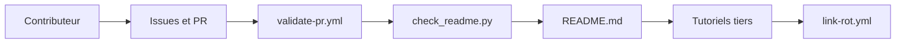

# practical-tutorials/project-based-learning

> Catalogue of tutorials where you build an application from scratch, sorted by language, for beginner developers.

## The problem
Learning a language through isolated exercises gets tiring fast. Finding tutorials that end in a real project, in the right language, means digging around the web.

## What it actually does
The README is both the content and the presentation: links to external tutorials, sorted by language (C/C++, Python, Go, Rust, JavaScript…) and then by theme. The Python section covers scraping, bots, data science, machine learning, OpenCV and deep learning. The repository hosts no code and no application. A `check_readme.py` script validates the format, and a `link-rot.yml` workflow watches for dead links.

## How it is wired

## Trying it
No usage command is documented: the README invites you to fork the repository to contribute, and points to CONTRIBUTING.md.

## Cost and gotchas
Free. The tutorials are on third-party sites: some are video, some are marked "outdated" (Haskell) or "in progress", and freshness varies from one link to the next.

## What it is not
Not a structured course nor a repository of runnable code: it is a directory of links. The tutorials are neither tested nor rated.

## Alternatives
- Exercism: cited under "Additional Resources", for guided exercises.
- CodeCrafters: cited in the same block, for rebuilding tools.
- Hack Club Workshops: also cited, project-oriented workshops.

## For you
Worth watching: the Python sections (data science, ML, OpenCV) give useful starter projects, but the directory does not replace a targeted data/AI watch.
