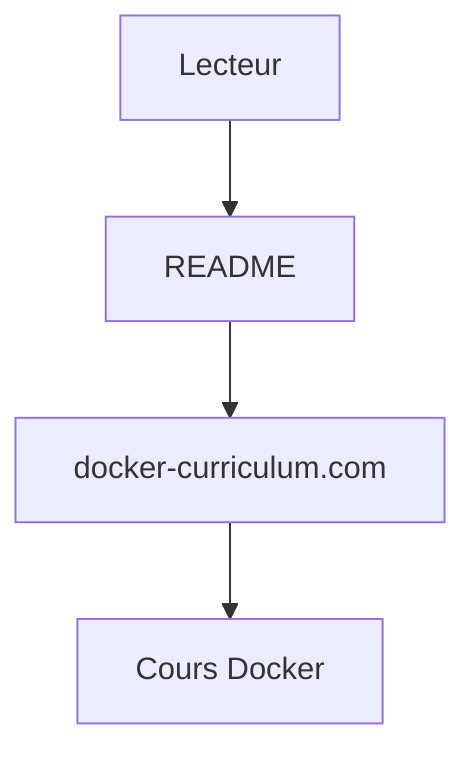

# prakhar1989/docker-curriculum

> Online tutorial for learning to build and deploy applications with Docker.

## The problem
Getting started with Docker without a guided path from containerization to cloud deployment.

## What it actually does
The README is three lines long: it points to the docker-curriculum.com site, where the course is. Nothing else is documented in the sheet.

## How it is wired

Simplified diagram based on the sheet, no diagram provided.

## Trying it
```bash
# Aucune commande documentée : suivre le cours sur docker-curriculum.com
```

## Cost and gotchas
Free. The content is outside the repository: not verified here. The course dates from 2015 (repository created), but the last push is from October 2026.

## What it is not
Not a tool nor executable code. The actual content (level, coverage, currency) is not described: to be read on the site.

## Alternatives
No alternative named in the README.

## For you
Worth watching: a classic reference for getting into Docker before MLOps, but the sheet has no substance to judge by.
