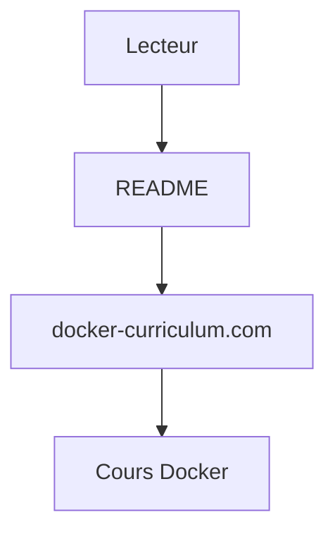

# prakhar1989/docker-curriculum

> Tutoriel en ligne pour apprendre à construire et déployer des applications avec Docker.

## Le problème
Débuter avec Docker sans parcours guidé de la conteneurisation au déploiement cloud.

## Ce que ça fait vraiment
Le README tient en trois lignes : il renvoie vers le site docker-curriculum.com, où se trouve le cours. Rien d'autre n'est documenté dans la fiche.

## Comment c'est branché

Schéma simplifié d'après la fiche, sans diagramme fourni.

## Essayer
```bash
# Aucune commande documentée : suivre le cours sur docker-curriculum.com
```

## Coût et pièges
Gratuit. Le contenu est hors dépôt : non vérifié ici. Le cours date de 2015 (dépôt créé), mais le dernier push est d'octobre 2026.

## Ce que ce n'est pas
Pas un outil ni du code exécutable. Le contenu réel (niveau, couverture, actualité) n'est pas décrit : à lire sur le site.

## Alternatives
Aucune alternative nommée dans le README.

## Pour toi
À surveiller : référence classique pour se mettre à Docker avant le MLOps, mais fiche sans matière pour juger.

