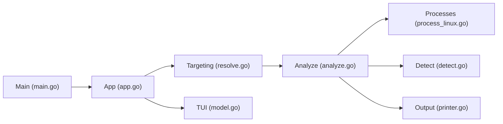

# pranshuparmar/witr

> CLI and TUI that explain why a process, port, container or file exists.

## The problem
`ps`, `lsof`, `ss`, `systemctl`, `docker ps` show what is running, not why. Tracing back to systemd, pm2, cron or a container means cross-referencing several outputs by hand.

## What it actually does
Resolves any target to a PID, then builds the ancestry chain (e.g. `systemd → pm2 → node`).
Names a primary source (systemd, launchd, cron, SSH, tmux, container…) and adds context: directory, Git repository, sockets.
Emits warnings: root, public listening, dangerous capabilities, deleted binary, LD_PRELOAD.
Text, tree and JSON outputs, exit codes for scripts; four-tab TUI. Linux, macOS, Windows, FreeBSD.

## How it is wired


## Trying it
```bash
curl -fsSL https://raw.githubusercontent.com/pranshuparmar/witr/main/install.sh | bash
brew install witr
witr node
witr --port 5000 --short
witr --pid 143895 --tree
```

## Cost and gotchas
Free, static binary. Some information requires `sudo`; on macOS, SIP masks part of it.

## What it is not
Not a continuous monitoring or alerting tool. Source detection is "best effort". A single-author project, recent (late 2025).

## Alternatives
No named alternative; the README cites `ps`, `lsof`, `ss`, `systemctl` as tools it complements.

## For you
Adopt: on a GPU machine or a shared server, knowing in one command who launched the process holding port 8000 or the VRAM saves time.
