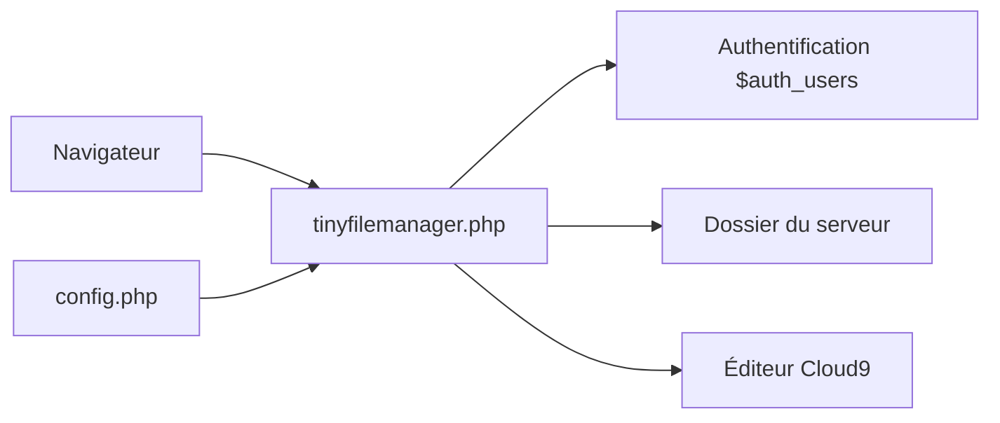

# prasathmani/tinyfilemanager

> Single-file PHP web file manager, to drop onto a server.

## The problem
Managing files on a remote server without shell access calls for a lightweight tool in the browser.

## What it actually does
A single file `tinyfilemanager.php` lets you create, edit, copy, move, upload and download files, and compress them as zip or tar. It includes the Cloud9 editor, user accounts with their own root folder, and an IP blacklist or whitelist.

## How it is wired

Simplified diagram based on the fiche, no diagram provided.

## Trying it
```bash
# Copier tinyfilemanager.php dans l'espace web du serveur.
# Identifiants par défaut : admin/admin@123 et user/12345 (à changer)
```

## Cost and gotchas
Free. The default credentials are public: change them before any use. The README advises against exposing it publicly and asks you to remove it after use. PHP 5.5 or later. The Docker section is empty in the supplied README.

## What it is not
It is not a tool to leave permanently on an exposed server, according to the author himself.

## Alternatives
The README names none.

## For you
Ignore: a PHP file manager with real exposure risk, of no interest for data / AI / MLOps work.
