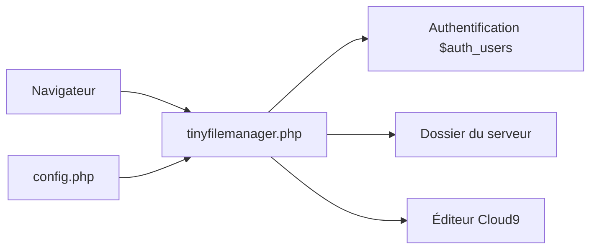

# prasathmani/tinyfilemanager

> Gestionnaire de fichiers web en un seul fichier PHP, à déposer sur un serveur.

## Le problème
Gérer des fichiers sur un serveur distant sans accès shell demande un outil léger dans le navigateur.

## Ce que ça fait vraiment
Un seul fichier `tinyfilemanager.php` permet de créer, modifier, copier, déplacer, téléverser et télécharger des fichiers, et de les compresser en zip ou tar. Il inclut l'éditeur Cloud9, des comptes utilisateurs avec dossier racine propre et une liste noire ou blanche d'IP.

## Comment c'est branché

Schéma simplifié d'après la fiche, sans diagramme fourni.

## Essayer
```bash
# Copier tinyfilemanager.php dans l'espace web du serveur.
# Identifiants par défaut : admin/admin@123 et user/12345 (à changer)
```

## Coût et pièges
Gratuit. Les identifiants par défaut sont publics : à changer avant tout usage. Le README déconseille de l'exposer en public et demande de le retirer après usage. PHP 5.5 ou plus. La section Docker est vide dans le README fourni.

## Ce que ce n'est pas
Ce n'est pas un outil à laisser en permanence sur un serveur exposé, selon l'auteur lui-même.

## Alternatives
Le README n'en nomme aucune.

## Pour toi
À ignorer : gestionnaire de fichiers PHP au risque d'exposition réel, sans intérêt pour un travail data / IA / MLOps.

