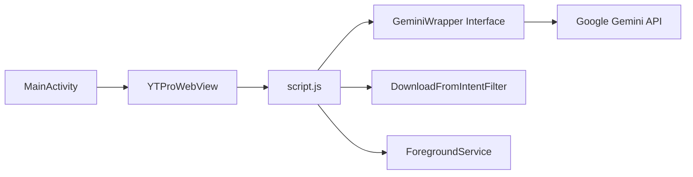

# prateek-chaubey/YTPro

> Android YouTube client built on a WebView with injected scripts: download, ad blocker, Gemini summary.

## The problem
The official YouTube app offers neither downloading, free background playback, nor AI summaries.

## What it actually does
An APK whose `MainActivity` loads YouTube in a WebView and injects `bgplay.js`, `innertube.js`, `script.js`. A Java bridge exposes downloading and `GeminiWrapper` (video summary, customizable prompt with `{url}`, `{title}`, `{videoId}`). A foreground service handles background audio. Reuses SponsorBlock and return-youtube-dislike.

## How it is wired

## Trying it
The README gives no command; it points to an APK download.

## Cost and gotchas
Free; a Gemini key is needed for the summary. The README presents the project as educational. Bypassing ads and downloading goes against YouTube's terms of use.

## What it is not
Not a data/AI tool. Last push in July 2025, less than a year as of the summary date: no age alert.

## Alternatives
No alternative named in the README.

## For you
Ignore: a consumer mobile app with no link to data/AI work, and a gray area with respect to YouTube's terms.
