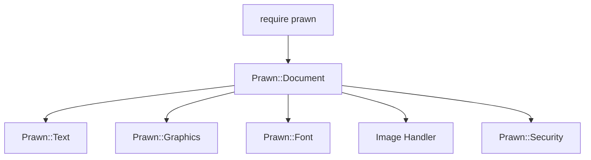

# prawnpdf/prawn

> Pure Ruby library to generate PDFs programmatically: text, drawing, images, encryption.

## The problem
Producing PDFs from Ruby code without going through a browser or an external tool.

## What it actually does
Prawn creates documents with vector drawing, text (limited formatting, TrueType fonts, right-to-left text), PNG and JPG images, a simple grid, headers, footers, outlines and password encryption. You can go down to the PDF object tree. It is not strictly versioned: experimental APIs exist.

## How it is wired


## Trying it
```bash
gem install prawn
```
```ruby
require "prawn"
Prawn::Document.generate("hello.pdf") do
  text "Hello World!"
end
```

## Cost and gotchas
Free. Requires Ruby, which is missing from the prerequisites list. The license is detected but not identified by GitHub: to be checked. Only one active maintainer.

## What it is not
Neither an HTML-to-PDF converter nor a ready-made reporting tool: the README points to Ferrum for HTML.

## Alternatives
Ferrum, cited by the README, to convert HTML to PDF.

## For you
Ignore: Ruby is outside your stack, and a PDF report is more naturally done from Python.
