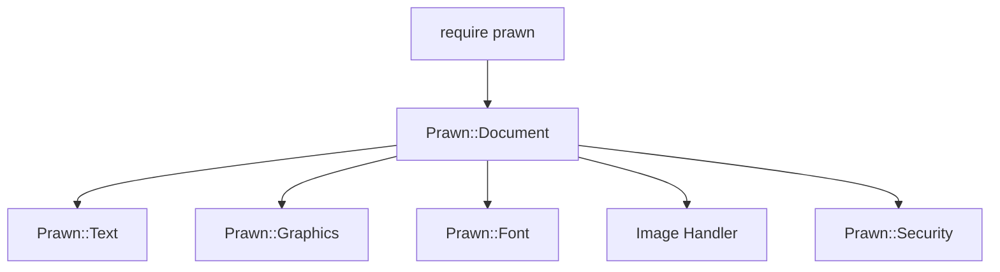

# prawnpdf/prawn

> Bibliothèque Ruby pure pour générer des PDF par programme : texte, dessin, images, chiffrement.

## Le problème
Produire des PDF depuis du code Ruby sans passer par un navigateur ou un outil externe.

## Ce que ça fait vraiment
Prawn crée des documents avec dessin vectoriel, texte (mise en forme limitée, polices TrueType, texte de droite à gauche), images PNG et JPG, grille simple, en-têtes, pieds de page, plans et chiffrement avec mot de passe. On peut descendre jusqu'à l'arbre d'objets PDF. Il n'est pas versionné strictement : des API expérimentales existent.

## Comment c'est branché


## Essayer
```bash
gem install prawn
```
```ruby
require "prawn"
Prawn::Document.generate("hello.pdf") do
  text "Hello World!"
end
```

## Coût et pièges
Gratuit. Demande Ruby, absent de la liste de prérequis. La licence est détectée mais non identifiée par GitHub : à vérifier. Un seul mainteneur actif.

## Ce que ce n'est pas
Ni un convertisseur HTML vers PDF, ni un outil de rapports tout fait : le README renvoie vers Ferrum pour le HTML.

## Alternatives
Ferrum, cité par le README, pour convertir du HTML en PDF.

## Pour toi
Ignorer : Ruby sort de ta pile, et un rapport PDF se fait plus naturellement depuis Python.

