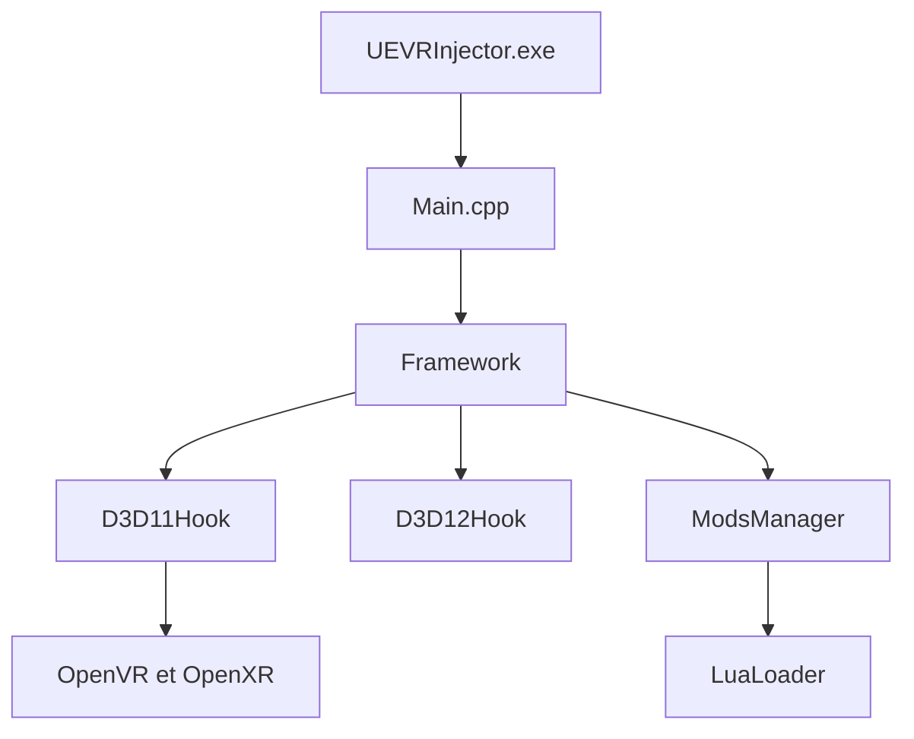

# praydog/UEVR

> Universal mod that adds virtual reality to Unreal Engine 4 and 5 games, for gamers.

## The problem
Most Unreal Engine games have no official VR mode.

## What it actually does
An injector (`UEVRInjector.exe`) loads a DLL into the game. It hooks DirectX 11 and 12, inputs and Windows messages, then provides stereo rendering, head tracking, an in-game menu and OpenVR or OpenXR runtimes. Three rendering modes: native stereo, synchronized sequential and alternating. C++ plugins, Lua scripts and per-game configuration are possible.

## How it is wired

## Trying it
No documented command: launch `UEVRInjector.exe`, launch the game, pick it in the list, select OpenVR or OpenXR, then inject.

## Cost and gotchas
Windows, VR headset, .NET 6.0 SDK and a suitable GPU. License detected but not identified by GitHub: to be checked. May crash depending on the game; disable DLSS Frame Generation and overlays.

## What it is not
Not an official solution: the mod injects itself into third-party processes. Results vary by game.

## Alternatives
No alternative named in the README.

## For you
Ignore: a VR game mod for Windows, unrelated to your data or AI practice.
