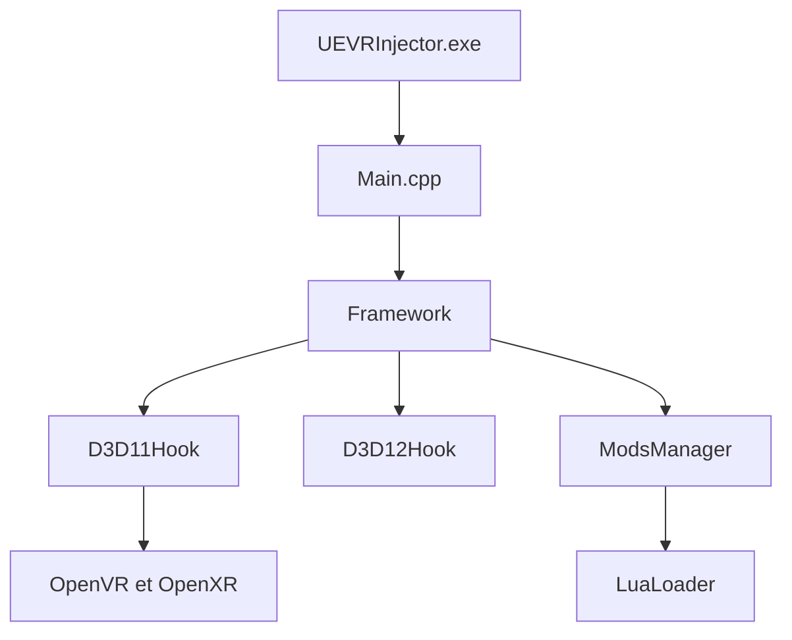

# praydog/UEVR

> Mod universel qui ajoute la réalité virtuelle à des jeux Unreal Engine 4 et 5, pour joueurs.

## Le problème
La plupart des jeux Unreal Engine n'ont pas de mode VR officiel.

## Ce que ça fait vraiment
Un injecteur (`UEVRInjector.exe`) charge une DLL dans le jeu. Elle accroche DirectX 11 et 12, les entrées et les messages Windows, puis fournit rendu stéréo, suivi de la tête, menu en jeu et runtimes OpenVR ou OpenXR. Trois modes de rendu : stéréo native, séquentiel synchronisé et alterné. Plugins C++, scripts Lua et configuration par jeu sont possibles.

## Comment c'est branché

## Essayer
Aucune commande documentée : lancer `UEVRInjector.exe`, lancer le jeu, le choisir dans la liste, sélectionner OpenVR ou OpenXR, puis injecter.

## Coût et pièges
Windows, casque VR, SDK .NET 6.0 et GPU adapté. Licence détectée mais non identifiée par GitHub : à vérifier. Peut planter selon le jeu ; désactiver DLSS Frame Generation et les surcouches.

## Ce que ce n'est pas
Pas une solution officielle : le mod s'injecte dans des processus tiers. Résultats variables selon le jeu.

## Alternatives
Aucune alternative nommée dans le README.

## Pour toi
Ignorer : un mod de jeu VR sous Windows, sans lien avec ta pratique data ou IA.

