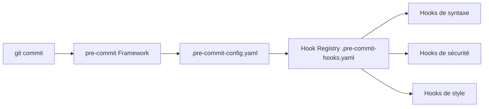

# pre-commit/pre-commit-hooks

> Collection of ready-to-use hooks for the pre-commit framework: formats, syntax, secrets.

## The problem
Large files, invalid YAML, private keys or merge conflicts slip into commits.

## What it actually does
About thirty hooks: `check-added-large-files`, `check-yaml/json/toml/xml`, `check-ast`, `detect-private-key`, `detect-aws-credentials`, `end-of-file-fixer`, `trailing-whitespace`, `pretty-format-json`, `requirements-txt-fixer`, `no-commit-to-branch`, `check-merge-conflict`. Several are configurable through arguments. Also installable as a standalone package.

## How it is wired


## Trying it
```yaml
-   repo: https://github.com/pre-commit/pre-commit-hooks
    rev: v6.0.0
    hooks:
    -   id: trailing-whitespace
```
```bash
pip install pre-commit-hooks
```

## Cost and gotchas
Free. The `check-added-large-files` hook sets 500 kB by default; `no-commit-to-branch` always runs (`always_run`). Several hooks are declared deprecated (`check-docstring-first`, `fix-encoding-pragma`).

## What it is not
Not a full Python linting tool: pair it with ruff, black or something else. Not an exhaustive secrets scanner: only private keys and AWS credentials.

## Alternatives
The pre-commit framework itself (pre-commit/pre-commit repository), for running the hooks.

## For you
Adopt: a few lines in a config file block large files and private keys before they land in a models or notebooks repository.
