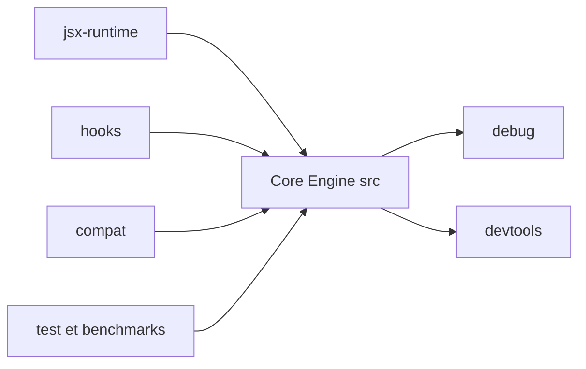

# preactjs/preact

> JavaScript virtual-DOM component library, React-compatible, for developers of lightweight web interfaces.

## The problem
A component-based interface is expensive in weight and rendering time when the whole framework is shipped. Preact aims at the same API as React with less overhead.

## What it actually does
The core (`src`) creates elements, computes the differences between two trees and updates the DOM in place. Separate modules add hooks, a JSX runtime, a `compat` layer to alias React, as well as debugging and DevTools. Asynchronous rendering goes through a replaceable scheduler.

## How it is wired


## Trying it
```bash
# Le README ne documente pas de commande d'installation ; il montre du code :
# import { h, render } from 'preact';
# import { useState } from 'preact/hooks';
```

## Cost and gotchas
Free, no key. A JSX build chain is required (Babel or tsconfig's `jsxFactory`): the README mentions it.

## What it is not
It is not React: compatibility goes through the `preact/compat` alias and is only described as "extensive", not complete. Nor is it a full framework: routing and state remain to be assembled.

## Alternatives
- React: the reference API, which Preact imitates through `preact/compat`.

## For you
Worth watching: it is web front-end, outside the data/AI/MLOps core, but useful if you have to deliver a small interface (dashboard, model demo) without weighing down the page.
