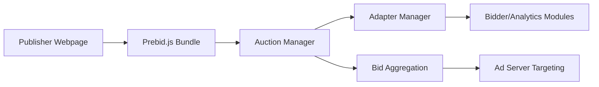

# prebid/Prebid.js

> JavaScript "header bidding" library for publishers who sell their ad space.

## The problem
A publisher who wants to make several ad exchanges compete before calling their ad server has to integrate each one by hand.

## What it actually does
A core (auction management, adapters, consent, storage) and hundreds of modules (bidder adapters, analytics, identifiers) that you choose at build time with `--modules`. Build options to strip video, native or logs. This README is aimed at contributors. An agent skill (Chrome DevTools) is mentioned.

## How it is wired


## Trying it
```bash
git clone https://github.com/prebid/Prebid.js.git
cd Prebid.js
npm ci
gulp serve-and-test --file
gulp build --modules=openxBidAdapter,rubiconBidAdapter,sovrnBidAdapter
```

## Cost and gotchas
Free; Node and a global `gulp-cli`. The README reminds that legal compliance remains the publisher's responsibility.

## What it is not
Not a compliance guarantee (GDPR, etc.). Not a data analysis tool.

## Alternatives
No alternative named in the README.

## For you
Ignore: browser-side programmatic advertising, outside the data/AI/MLOps scope.
