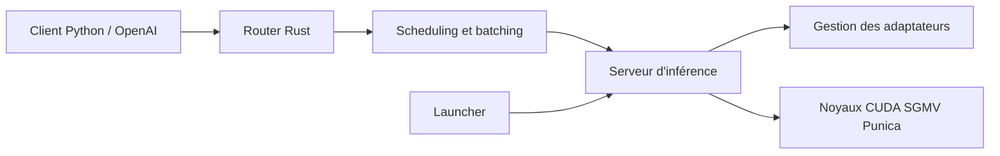

# predibase/lorax

> Inference server that serves thousands of LoRA adapters on a single GPU, for MLOps teams.

## The problem
Serving a model fine-tuned per customer or per task means dedicating a GPU to each one, which makes the bill explode.

## What it actually does
A base model (Llama, Mistral, Qwen) stays in memory; the requested LoRA adapter is loaded on the fly from HuggingFace, Predibase or a disk, without blocking other requests. Continuous batching mixes requests targeting different adapters, and adapters move between GPU and CPU depending on demand. The API is REST, OpenAI-compatible for chat (the adapter is passed in `model`), with a Python client.

## How it is wired


## Trying it
```bash
model=mistralai/Mistral-7B-Instruct-v0.1
volume=$PWD/data
docker run --gpus all --shm-size 1g -p 8080:80 -v $volume:/data \
    ghcr.io/predibase/lorax:main --model-id $model
pip install lorax-client
```

## Cost and gotchas
Nvidia GPU of the Ampere generation or later, CUDA 11.8+, Linux, nvidia-container-toolkit. The README recommends the Docker image to avoid compiling the CUDA kernels. 186 open issues.

## What it is not
It is not a training tool: it serves adapters that have already been produced (PEFT, Ludwig). It does not replace a general-purpose server if you only have a single fine-tuned model.

## Alternatives
No alternative is named in the README (the original server it derives from is not cited there).

## For you
Adopt it if you need to serve many LoRA variants at low cost: Apache-2.0 license, recent push, Docker and Helm provided; otherwise useless.
