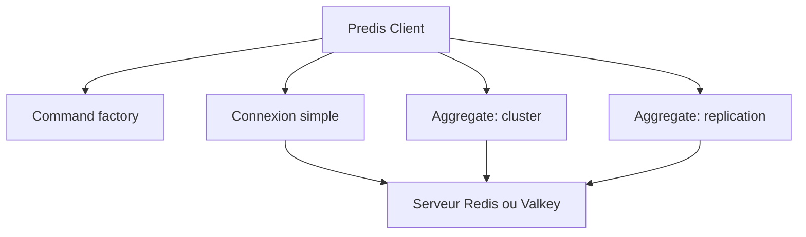

# predis/predis

> Pure-PHP Redis and Valkey client, with clustering, replication and pipelines.

## The problem
Talking to Redis from PHP without a native extension, with cluster, sentinel and transactions handled.

## What it actually does
Predis supports Redis 3.0 to 8.0: redis-cluster, client-side sharding, master-slave replication, sentinel, pipelines, MULTI/EXEC transactions with CAS, Lua scripts (EVALSHA/EVAL), SCAN iterators, key prefixing, TLS and mTLS. Lazy or persistent connections. Customizable commands. Optional Relay integration.

## How it is wired


## Trying it
```bash
composer require predis/predis
```
```php
$client = new Predis\Client();
$client->set('foo', 'bar');
$value = $client->get('foo');
```

## Cost and gotchas
Free; a reachable Redis or Valkey server is required. PHP 7.2 or later. HIMPORT is experimental and depends on the retry policy. README truncated in the block.

## What it is not
Not a Redis server. Client-side `predis` clustering requires external supervision and manual rebalancing.

## Alternatives
Relay: native extension with shared in-memory cache, can be integrated.

## For you
Adopt only if your service is in PHP; without PHP, no interest for a data/AI profile.
