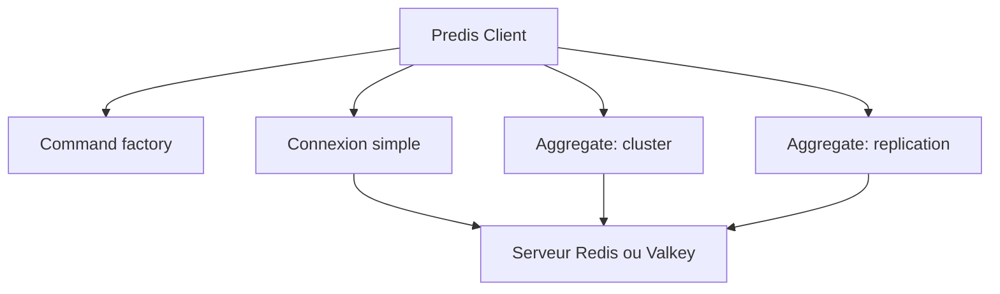

# predis/predis

> Client Redis et Valkey en PHP pur, avec clustering, réplication et pipelines.

## Le problème
Dialoguer avec Redis depuis PHP sans extension native, avec cluster, sentinel et transactions gérés.

## Ce que ça fait vraiment
Predis supporte Redis 3.0 à 8.0 : redis-cluster, sharding client, réplication maître-esclave, sentinel, pipelines, transactions MULTI/EXEC avec CAS, scripts Lua (EVALSHA/EVAL), itérateurs SCAN, préfixage de clés, TLS et mTLS. Connexions paresseuses ou persistantes. Commandes personnalisables. Intégration optionnelle de Relay.

## Comment c'est branché


## Essayer
```bash
composer require predis/predis
```
```php
$client = new Predis\Client();
$client->set('foo', 'bar');
$value = $client->get('foo');
```

## Coût et pièges
Gratuit ; il faut un serveur Redis ou Valkey accessible. PHP 7.2 ou plus. HIMPORT est expérimental et dépend de la politique de retry. README tronqué dans le bloc.

## Ce que ce n'est pas
Pas un serveur Redis. Le clustering `predis` côté client demande une supervision externe et un rééquilibrage manuel.

## Alternatives
Relay : extension native avec cache en mémoire partagée, intégrable.

## Pour toi
À adopter seulement si ton service est en PHP ; sans PHP, aucun intérêt pour un profil data/IA.

