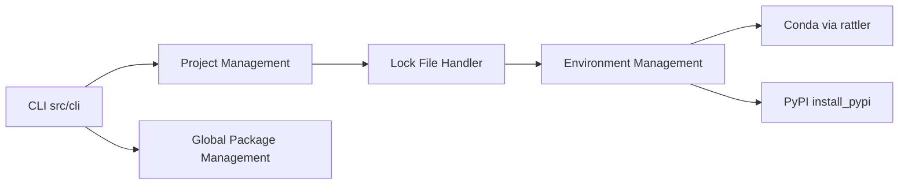

# prefix-dev/pixi

> Multi-language package and environment manager on the conda ecosystem, with a lockfile, for data scientists.

## The problem
Reproducing a cross-platform Python/C++/R environment with conda and pip requires manual assembly and fragile lockfiles.

## What it actually does
Rust CLI built on rattler: `pixi add`, `run`, `shell`, `task`, `global install` (pipx-style). Always up-to-date lockfile, per-project tasks, PyPI integration, `setup-pixi` GitHub action. The README still announces as upcoming: building and publishing conda packages, dependencies from source.

## How it is wired


## Trying it
```bash
curl -fsSL https://pixi.sh/install.sh | sh
pixi init myworkspace
cd myworkspace
pixi add cowpy
pixi run cowpy "Thanks for using pixi"
```

## Cost and gotchas
Free. The install script is a `curl | sh`: read it first. No longer published on crates.io. 683 open issues.

## What it is not
Not a new package format: it reuses conda and PyPI. Not a pipeline orchestrator.

## Alternatives
The README compares it to cargo and npm for ergonomics, and cites pipx and condax for global installation.

## For you
Adopt: reproducible environments for ML projects with a lockfile, simpler than conda alone.
