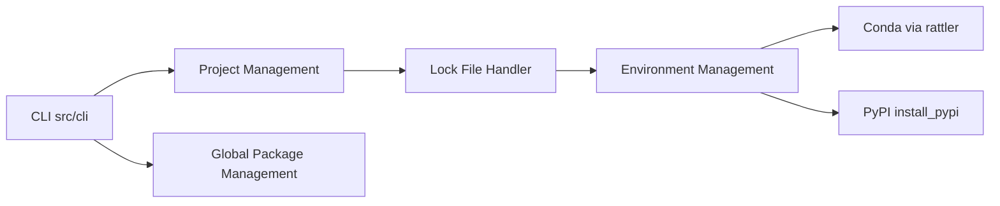

# prefix-dev/pixi

> Gestionnaire de paquets et d'environnements multi-langages sur l'écosystème conda, avec lockfile, pour data scientists.

## Le problème
Reproduire un environnement Python/C++/R multiplateforme avec conda et pip demande de l'assemblage manuel et des lockfiles fragiles.

## Ce que ça fait vraiment
CLI en Rust bâtie sur rattler : `pixi add`, `run`, `shell`, `task`, `global install` (à la pipx). Lockfile toujours à jour, tâches par projet, intégration PyPI, action GitHub `setup-pixi`. Le README annonce encore à venir : build et publication de paquets conda, dépendances depuis les sources.

## Comment c'est branché


## Essayer
```bash
curl -fsSL https://pixi.sh/install.sh | sh
pixi init myworkspace
cd myworkspace
pixi add cowpy
pixi run cowpy "Thanks for using pixi"
```

## Coût et pièges
Gratuit. Le script d'installation est un `curl | sh` : à relire. Plus publié sur crates.io. 683 issues ouvertes.

## Ce que ce n'est pas
Pas un nouveau format de paquets : il réutilise conda et PyPI. Pas un orchestrateur de pipelines.

## Alternatives
Le README compare à cargo et npm pour l'ergonomie, et cite pipx et condax pour l'installation globale.

## Pour toi
À adopter : environnements reproductibles pour projets ML avec lockfile, plus simples que conda seul.

