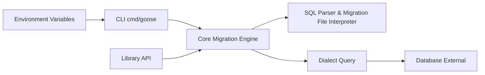

# pressly/goose

> Database schema migration tool, as a CLI and a Go library.

## The problem
Evolving a SQL schema across several environments without version tracking leads to diverging databases.

## What it actually does
Migrations in annotated SQL (`-- +goose Up` / `Down`) or Go functions, tracked in the `goose_db_version` table.
Commands: up, up-to, down, redo, reset, status, version, create, fix, validate.
Drivers for Postgres, MySQL, SQLite, Spanner, MSSQL, ClickHouse, Redshift, YDB, Turso…; migrations can be embedded via `embed`.
Transactions by default, environment variable substitution, out-of-order migrations with `-allow-missing`.

## How it is wired


## Trying it
```bash
go install github.com/pressly/goose/v3/cmd/goose@latest
goose sqlite3 ./foo.db create init sql
goose sqlite3 ./foo.db up
goose sqlite3 ./foo.db status
```

## Cost and gotchas
Free; Go migrations require compiling your own goose binary.
MySQL: `parseTime` and `multiStatements` are mandatory. License not identified by GitHub.

## What it is not
Not an ORM nor a generator of migrations from models.
Library in Go only; as a CLI, usable for any project.

## Alternatives
No alternative named in the README.

## For you
Worth watching: a pure SQL migration CLI, useful for versioning the schema of a warehouse or feature store outside the Python ecosystem; check the license.
