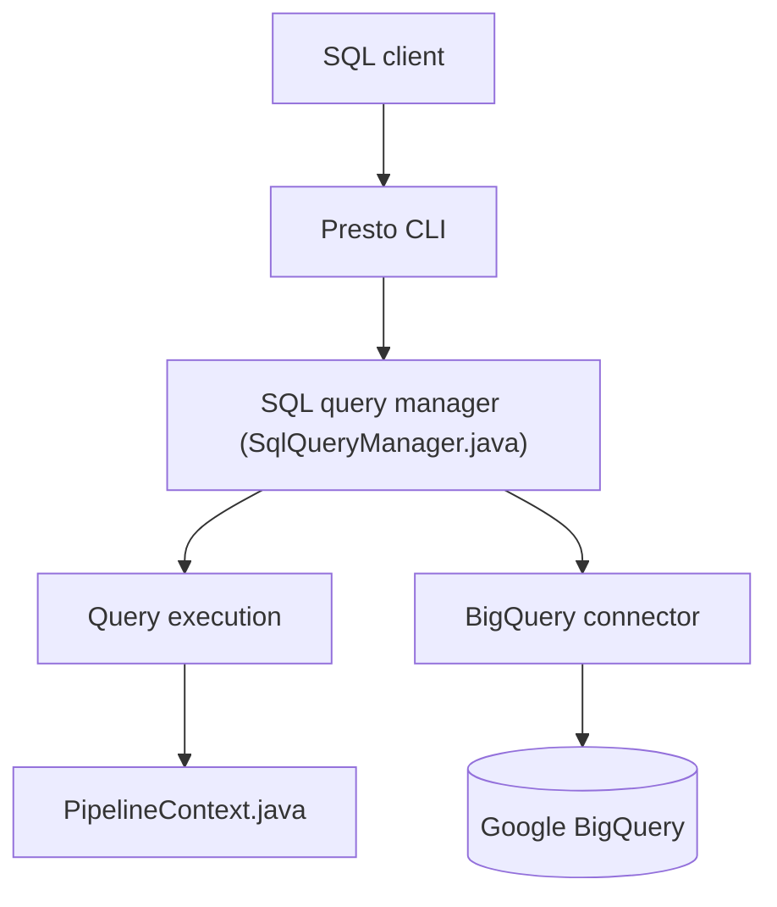

# prestodb/presto

> Distributed SQL query engine for big data, querying multiple sources through connectors.

## The problem
Querying in SQL large volumes spread across several systems (Hive, HDFS, BigQuery) without copying the data.

## What it actually does
A server receives the SQL, manages the query lifecycle (session, state, statistics) and runs it in a distributed fashion in stages. Connectors (including BigQuery) link the sources. Shipped with a CLI and a React web console; Presto native rewrites the worker in C++ with Velox.

## How it is wired


## Trying it
```bash
./mvnw clean install
./mvnw clean install -DskipTests
presto-cli/target/presto-cli-*-executable.jar
```
The README's test SQL query is `SELECT * FROM system.runtime.nodes;`.

## Cost and gotchas
Free. Requires Java 17, Maven 3.6.3+ and Python 2.4+ for the launcher script. Under Java 17, many `--add-opens` flags are needed. The README provided mostly details development.

## What it is not
Not a database: no storage of its own, it queries other sources. Not a one-click installation tool.

## Alternatives
- Presto native and Velox: C++ worker from the same project, for better performance.

## For you
Watch: useful if your data lake needs federated SQL, but heavy to deploy for a small volume.
