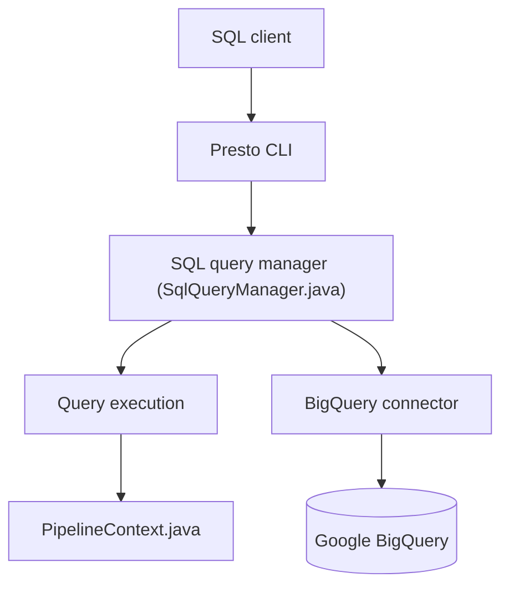

# prestodb/presto

> Moteur de requêtes SQL distribué pour le big data, interrogeant plusieurs sources via des connecteurs.

## Le problème
Interroger en SQL de grands volumes répartis sur plusieurs systèmes (Hive, HDFS, BigQuery) sans copier les données.

## Ce que ça fait vraiment
Un serveur reçoit le SQL, gère le cycle de vie des requêtes (session, état, statistiques) et les exécute en distribué par étapes. Des connecteurs (dont BigQuery) relient les sources. Livré avec une CLI et une console web React ; Presto native réécrit le worker en C++ avec Velox.

## Comment c'est branché


## Essayer
```bash
./mvnw clean install
./mvnw clean install -DskipTests
presto-cli/target/presto-cli-*-executable.jar
```
La requête SQL de test du README est `SELECT * FROM system.runtime.nodes;`.

## Coût et pièges
Gratuit. Exige Java 17, Maven 3.6.3+ et Python 2.4+ pour le script de lancement. Sous Java 17, de nombreux drapeaux `--add-opens` sont nécessaires. Le README fourni détaille surtout le développement.

## Ce que ce n'est pas
Pas une base de données : pas de stockage propre, il interroge d'autres sources. Pas un outil d'installation en un clic.

## Alternatives
- Presto native et Velox : worker en C++ du même projet, pour de meilleures performances.

## Pour toi
Surveiller : utile si ton lac de données demande du SQL fédéré, mais lourd à déployer pour un petit volume.

