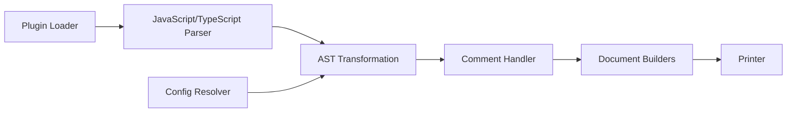

# prettier/prettier

> An opinionated code formatter for JavaScript, TypeScript, CSS, HTML, JSON, Markdown, YAML and other languages.

## The problem
Code reviews get bogged down in style remarks, and every developer formats in their own way.

## What it actually does
It parses the code, then reprints it with its own rules, taking the maximum line length into account and breaking lines when needed. It runs on save in the editor, as a pre-commit hook or in CI. The README lists the supported languages and points to the docs for installation, options, the CLI and the API.

## How it is wired

Note: the architecture text provided is a guide for drawing a diagram, not a description drawn from the code; the components above come from the graph list.

## Trying it
No command documented in the README (it points to the installation docs and the online playground).

## Cost and gotchas
Free. The distribution method is not specified in the README, only through links. Many open issues (1,434).

## What it is not
It is not a linter: it does not detect bugs, it only rewrites formatting. Its style choices are deliberately hard to configure.

## Alternatives
No alternative named in the README.

## For you
Adopt: an MLOps repo contains YAML, JSON and Markdown, and a pre-commit hook removes style debates effortlessly.
