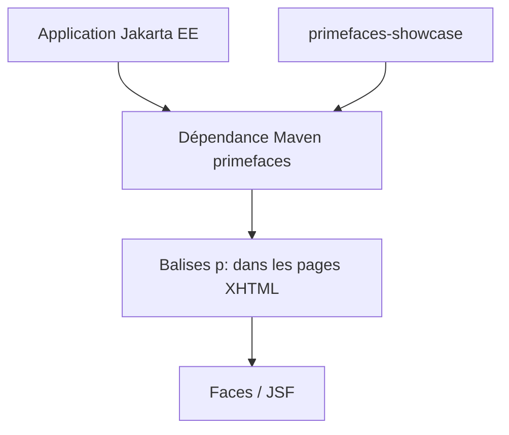

# primefaces/primefaces

> UI component library for Java Jakarta EE applications, added via Maven.

## The problem
Building rich web interfaces in JSF takes many components that the standard does not provide.

## What it actually does
Provides ready-to-use components for Jakarta Faces (`p:` tags), with a demo showcase. The README describes a branch-based lifecycle: active, maintenance, security, end of life. Version 17 is in development, 16 is released.

## How it is wired
Simplified diagram based on the sheet, no diagram provided.


## Trying it
```bash
# Aucune commande shell dans le README : on ajoute la dépendance Maven
# org.primefaces:primefaces:16.0.0 puis la balise <p:spinner /> dans une page XHTML.
```

## Cost and gotchas
Free (MIT). You need Java and a servlet container or application server, a requirement missing from the prerequisites list. Older javax versions only receive security fixes.

## What it is not
Not a tool for data or AI: it is server-side Java user interface.

## Alternatives
No alternative named in the README.

## For you
Ignore: Java EE UI library, no use in data, AI or MLOps work.
