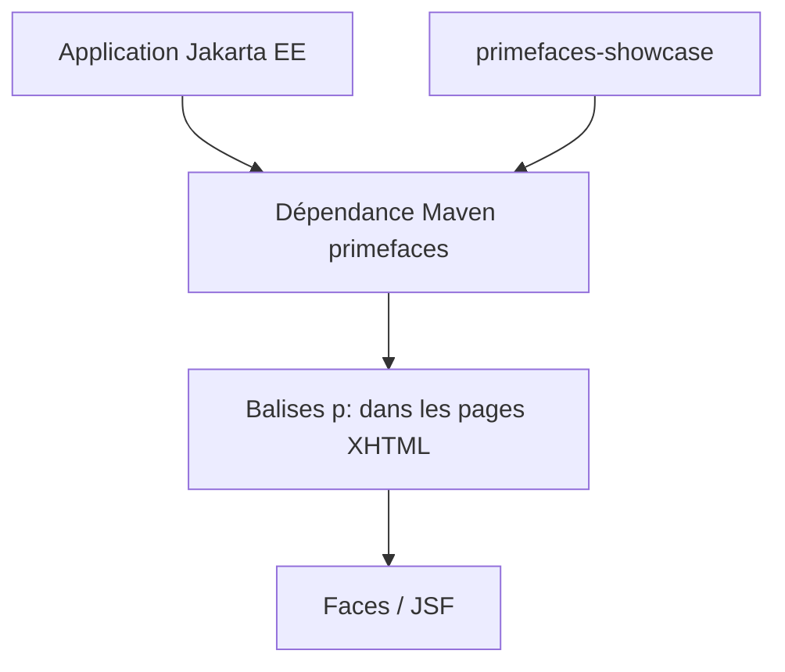

# primefaces/primefaces

> Bibliothèque de composants d'interface pour applications Java Jakarta EE, à ajouter par Maven.

## Le problème
Construire des interfaces web riches en JSF demande beaucoup de composants que le standard ne fournit pas.

## Ce que ça fait vraiment
Fournit des composants prêts à l'emploi pour Jakarta Faces (balises `p:`), avec une vitrine de démonstration. Le README décrit un cycle de vie par branches : active, maintenance, sécurité, fin de vie. La version 17 est en développement, la 16 est publiée.

## Comment c'est branché
Schéma simplifié d'après la fiche, sans diagramme fourni.


## Essayer
```bash
# Aucune commande shell dans le README : on ajoute la dépendance Maven
# org.primefaces:primefaces:16.0.0 puis la balise <p:spinner /> dans une page XHTML.
```

## Coût et pièges
Gratuit (MIT). Il faut Java et un conteneur de servlets ou serveur d'application, besoin absent de la liste des prérequis. Les anciennes versions javax ne reçoivent que des correctifs de sécurité.

## Ce que ce n'est pas
Pas un outil pour les données ni l'IA : c'est de l'interface utilisateur côté serveur Java.

## Alternatives
Aucune alternative nommée dans le README.

## Pour toi
À ignorer : bibliothèque d'interface Java EE, sans usage dans un travail data, IA ou MLOps.

