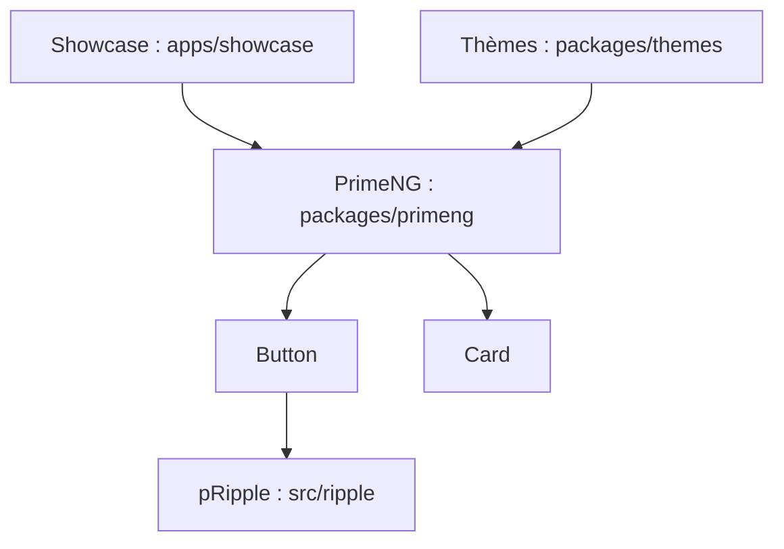

# primefaces/primeng

> Angular component library, now in security-only maintenance in favor of PrimeUI.

## The problem
Building a rich Angular interface requires dozens of ready-made components.

## What it actually does
This repository now only receives security fixes; development continues under PrimeUI. Existing MIT versions remain MIT. The diagram provided is generic: a monorepo with `packages/primeng`, `packages/themes` and the demo application `apps/showcase`.

## How it is wired


## Trying it
```bash
# Aucune commande documentée dans le README (avis de transition seulement).
```

## Cost and gotchas
Free for the MIT versions. Issues are read-only here: bugs and requests go to PrimeUI. The current license is not identified by GitHub.

## What it is not
Not an active repository for new features. The README is a transition notice, not usage documentation.

## Alternatives
PrimeUI (primeng.dev): the new home of active development.

## For you
Ignore: an Angular front-end library, at end of life on this repository and unrelated to your field.
