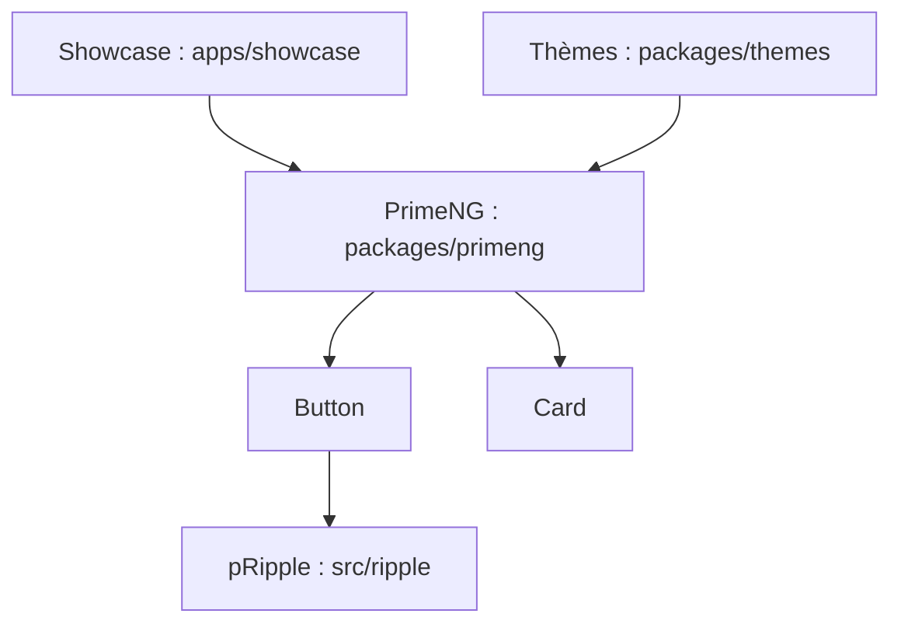

# primefaces/primeng

> Bibliothèque de composants Angular, désormais en maintenance de sécurité seulement au profit de PrimeUI.

## Le problème
Construire une interface Angular riche demande des dizaines de composants prêts à l'emploi.

## Ce que ça fait vraiment
Ce dépôt ne reçoit plus que des correctifs de sécurité ; le développement continue sous PrimeUI. Les versions MIT existantes restent MIT. Le diagramme fourni est générique : monorepo avec `packages/primeng`, `packages/themes` et l'application de démonstration `apps/showcase`.

## Comment c'est branché


## Essayer
```bash
# Aucune commande documentée dans le README (avis de transition seulement).
```

## Coût et pièges
Gratuit pour les versions MIT. Les issues sont en lecture seule ici : bugs et demandes vont chez PrimeUI. La licence actuelle n'est pas identifiée par GitHub.

## Ce que ce n'est pas
Pas un dépôt actif de nouveautés. Le README est un message de transition, pas une documentation d'usage.

## Alternatives
PrimeUI (primeng.dev) : le nouvel emplacement du développement actif.

## Pour toi
À ignorer : bibliothèque front Angular, en fin de vie sur ce dépôt et sans lien avec ton métier.

