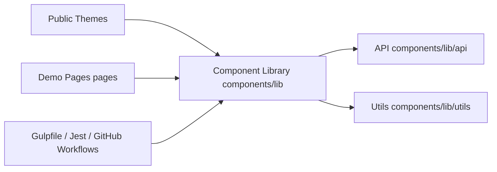

# primefaces/primereact

> React component library, now frozen on the open-source side and continued under PrimeUI.

## The problem
Build a rich React interface (tables, calendars, dialogs) without rewriting every component.

## What it actually does
UI component library in styled and unstyled modes, with themes. The repository is no longer developed: it only receives security fixes, issues are read-only and development continues at PrimeUI. Existing MIT versions remain MIT.

## How it is wired

## Trying it
No command documented in this README, which points to primereact.dev and to the announcement of the change.

## Cost and gotchas
Free for the MIT versions. For new features, you have to move to PrimeUI, whose license model is not described here.

## What it is not
Not an evolving library: feature requests are no longer handled there.

## Alternatives
- PrimeUI / primereact.dev: the project's official successor.

## For you
Ignore: front-end components with no direct link to data/AI, and the repository no longer evolves.
