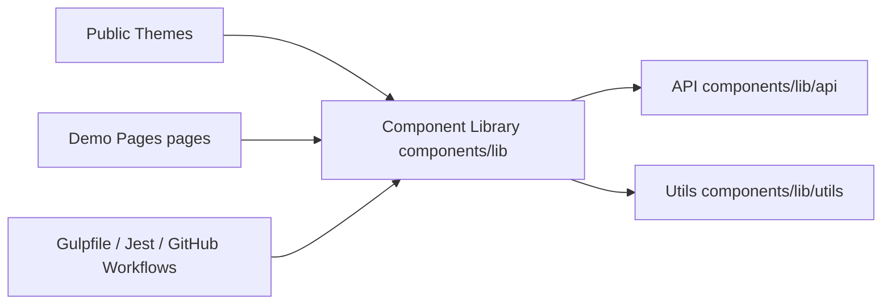

# primefaces/primereact

> Bibliothèque de composants React, désormais figée côté open source et poursuivie sous PrimeUI.

## Le problème
Construire une interface React riche (tableaux, calendriers, dialogues) sans réécrire chaque composant.

## Ce que ça fait vraiment
Bibliothèque de composants UI en modes stylé et sans style, avec thèmes. Le dépôt n'est plus développé : il ne reçoit que des correctifs de sécurité, les tickets sont en lecture seule et le développement continue chez PrimeUI. Les versions MIT existantes restent MIT.

## Comment c'est branché

## Essayer
Aucune commande documentée dans ce README, qui renvoie à primereact.dev et à l'annonce du changement.

## Coût et pièges
Gratuit pour les versions MIT. Pour des fonctions nouvelles, il faut passer chez PrimeUI dont le modèle de licence n'est pas décrit ici.

## Ce que ce n'est pas
Pas une bibliothèque en évolution : les demandes de fonctionnalités n'y sont plus traitées.

## Alternatives
- PrimeUI / primereact.dev : la suite officielle du projet.

## Pour toi
À ignorer : composants front sans rapport direct avec la data/IA, et le dépôt n'évolue plus.

