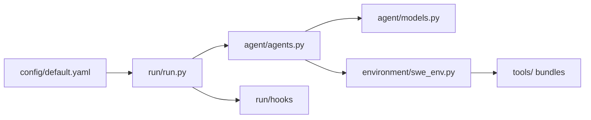

# princeton-nlp/SWE-agent

> Command-line agent that lets an LLM fix GitHub issues through shell tools, for research.

## The problem
Having a model resolve tickets on real repositories, and measuring its results, requires a reproducible agent/tools/execution loop.

## What it actually does
- A YAML file sets the model, prompts, tools and environment; the model is your choice.
- The agent loop (`agents.py`) calls the model, executes actions in a repository environment (`swe_env.py`) and iterates until submission.
- Single, batch and replay modes; hooks to apply a patch, evaluate on SWE-bench or open a pull request.
- A local trajectory inspector; EnIGMA mode for CTF challenges (version 0.7 recommended).

## How it is wired

## Trying it
No command in the README; it points to the documentation https://swe-agent.com (installation, hello world, SWE-bench) and to a Codespaces.

## Cost and gotchas
API key of the chosen model, at your expense; execution potentially in a container. GitHub identity not filled in (license, stars, dates), so check the license before any use.

## What it is not
It is no longer the priority project: the README states that mini-swe-agent has replaced it and recommends it. It is not a ready-to-use offensive security tool: EnIGMA awaits its update for version 1.0.

## Alternatives
mini-swe-agent, recommended by the README, simpler for comparable performance.

## For you
Worth watching: a useful reference for understanding a configuration-driven code agent, but start from mini-swe-agent for a new use.
