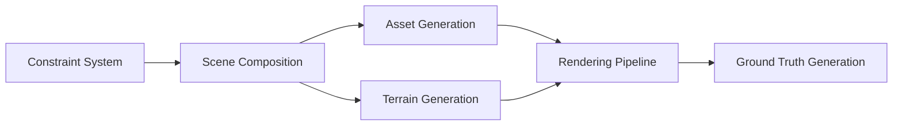

# princeton-vl/infinigen

> Procedural generator of photorealistic 3D worlds for vision and simulation research.

## The problem
Annotated 3D data (nature, interiors, articulated objects) is expensive to produce by hand for training models.

## What it actually does
Generates procedural scenes (nature, interiors, articulated assets for simulators) with extended ground truth, export to OBJ or OpenUSD, fluid simulation. The README is mostly an index pointing to the hosted documentation and to stable versions per theme. Described architecture: constraint system, terrain and asset generation, rendering pipeline, dependency on Blender and CUDA.

## How it is wired

## Trying it
No command documented in the README: the installation guides and "Hello World / Hello Room" are deferred to the hosted documentation.

## Cost and gotchas
Free. The required hardware is not detailed in the README; rendering involves Blender and a GPU according to the graph. You have to pick the right stable branch (nature, indoors, articulated).

## What it is not
Not a learned generative model: generation is procedural. The README gives no quick start.

## Alternatives
No alternative named in the README.

## For you
Worth watching: useful if you need annotated synthetic 3D data for vision or robotics, otherwise outside your scope.
