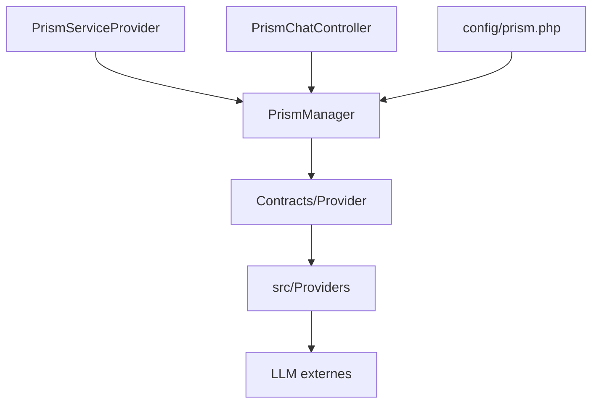

# prism-php/prism

> Laravel package that unifies access to several LLM providers: text, tools, conversations.

## The problem
Each LLM provider has its own API. A Laravel project must rewrite the integration to switch.

## What it actually does
Fluent interface to generate text, handle multi-step conversations and use tools. According to the architecture: Anthropic, DeepSeek, Gemini, Groq, Mistral, Ollama, OpenAI, VoyageAI and XAI providers, plus structured outputs, embeddings and a chat server.

## How it is wired

## Trying it
No command documented in the provided README: the documentation is on the project's official site.

## Cost and gotchas
Free, MIT. LLM calls are billed by each provider: API key at your expense. Very short README.

## What it is not
Not a full agent framework nor a model. It requires Laravel or PHP. Details not documented in the provided README.

## Alternatives
No alternative named in the README.

## For you
Watch: interesting only if your application is in PHP Laravel; otherwise, nothing more than one LLM client among others.
