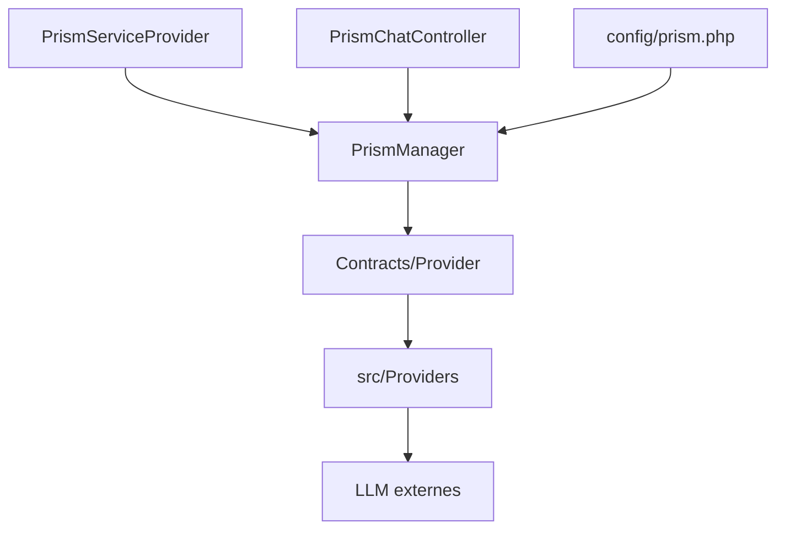

# prism-php/prism

> Paquet Laravel qui unifie l'accès à plusieurs fournisseurs de LLM : texte, outils, conversations.

## Le problème
Chaque fournisseur de LLM a son API. Un projet Laravel doit réécrire l'intégration pour en changer.

## Ce que ça fait vraiment
Interface fluide pour générer du texte, gérer des conversations en plusieurs étapes et utiliser des outils. D'après l'architecture : fournisseurs Anthropic, DeepSeek, Gemini, Groq, Mistral, Ollama, OpenAI, VoyageAI et XAI, plus sorties structurées, embeddings et un serveur de chat.

## Comment c'est branché

## Essayer
Aucune commande documentée dans le README fourni : la documentation est sur le site officiel du projet.

## Coût et pièges
Gratuit, MIT. Les appels aux LLM sont facturés par chaque fournisseur : clé d'API à ta charge. README très court.

## Ce que ce n'est pas
Pas un framework d'agents complet ni un modèle. Il demande Laravel ou PHP. Détails non documentés dans le README fourni.

## Alternatives
Aucune alternative nommée dans le README.

## Pour toi
À surveiller : intéressant seulement si ton application est en PHP Laravel ; sinon, rien de plus qu'un client LLM parmi d'autres.

