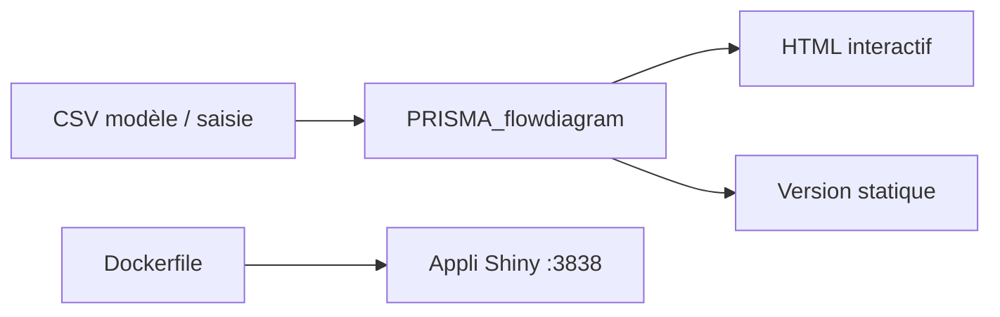

# prisma-flowdiagram/PRISMA2020

> R package and Shiny app producing PRISMA 2020 flow diagrams for systematic reviews.

## The problem
Systematic reviews require a flow diagram compliant with the PRISMA 2020 standard, which is slow to draw by hand.

## What it actually does
The `PRISMA_flowdiagram()` function generates the diagram from entered data or a CSV template (`INST/EXTDATA/`). With `interactive = TRUE`, interactive HTML output (boxes linked to pages, tooltips); otherwise a static version. The "Previous" and "Other" arms can be enabled.

## How it is wired


## Trying it
```bash
docker build . -t prisma-shiny:1
docker run -it --rm -p 3838:3838 prisma-shiny:1
# puis http://localhost:3838/app
```

## Cost and gotchas
Free. License present but not identified: check before reuse. Citation requested (Haddaway et al., 2022).

## What it is not
Not a systematic review tool: it only makes the diagram. It does not help with searching or study selection.

## Alternatives
No alternative named in the README.

## For you
Ignore: serves literature reviews, not a usual data/AI/MLOps flow.
