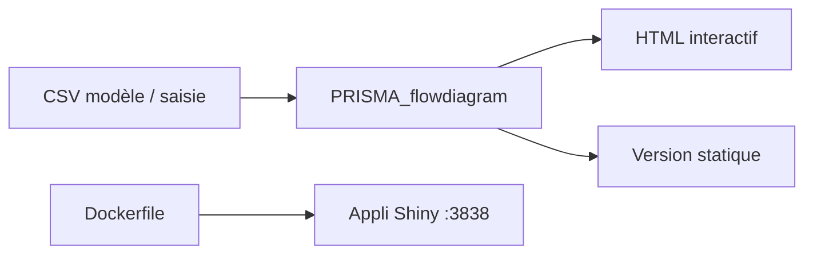

# prisma-flowdiagram/PRISMA2020

> Paquet R et appli Shiny produisant des diagrammes de flux PRISMA 2020 pour revues systématiques.

## Le problème
Les revues systématiques exigent un diagramme de flux conforme au standard PRISMA 2020, long à dessiner à la main.

## Ce que ça fait vraiment
La fonction `PRISMA_flowdiagram()` génère le diagramme à partir de données saisies ou d'un modèle CSV (`INST/EXTDATA/`). Avec `interactive = TRUE`, sortie HTML interactive (boîtes liées à des pages, infobulles) ; sinon version statique. Les bras « Previous » et « Other » sont activables.

## Comment c'est branché


## Essayer
```bash
docker build . -t prisma-shiny:1
docker run -it --rm -p 3838:3838 prisma-shiny:1
# puis http://localhost:3838/app
```

## Coût et pièges
Gratuit. Licence présente mais non identifiée : à vérifier avant réutilisation. Citation demandée (Haddaway et al., 2022).

## Ce que ce n'est pas
Ce n'est pas un outil de revue systématique : il ne fait que le diagramme. Il n'aide pas à la recherche ni à la sélection des études.

## Alternatives
Aucune alternative nommée dans le README.

## Pour toi
Ignorer : sert aux revues de littérature, pas à un flux data/IA/MLOps courant.

