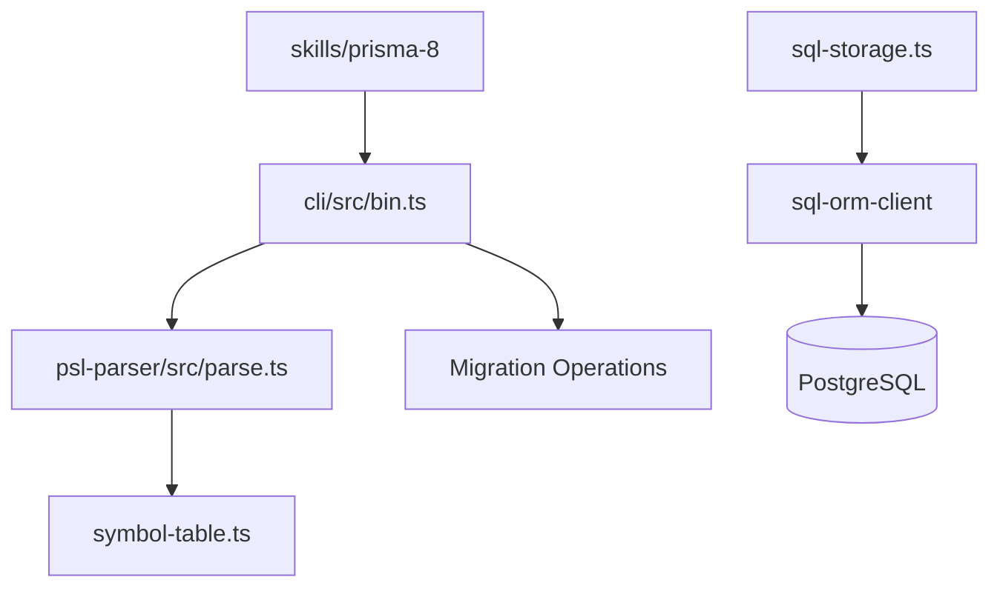

# prisma/orm

> ORM TypeScript Prisma 8 (candidate version), same repository as prisma/prisma but under a different name.

## The problem
Writing access to databases by hand results in repetitive, poorly structured code that is difficult to maintain and update.

## What it actually does
Identity and README are identical to prisma/prisma (same stars, same dates, 2,841 issues): this is the same repository, listed under two names. The PSL contract is analyzed, validated, and converted into either SQL or MongoDB storage, after which the ORM client executes the queries. This also includes CLI, a language server, migrations, and the skills of agents.

## How it is wired


## Trying it
```bash
npm create prisma
npx prisma orm init
npx prisma skills sync
```

## Cost and gotchas
Node.js version 24 or later. Candidate version with potential breaking changes. Command-line interface telemetry is visible in the graph (`sender.ts` to `handler.ts`).

## What it is not
This is not a second project: a duplicate of prisma/prisma. It is not stable until version 8.0.0 is released.

## Alternatives
No alternative is specified in the README file.

## For you
The verdict is the same as for prisma/prisma: only process it once, and monitor the final output before relying on it.
